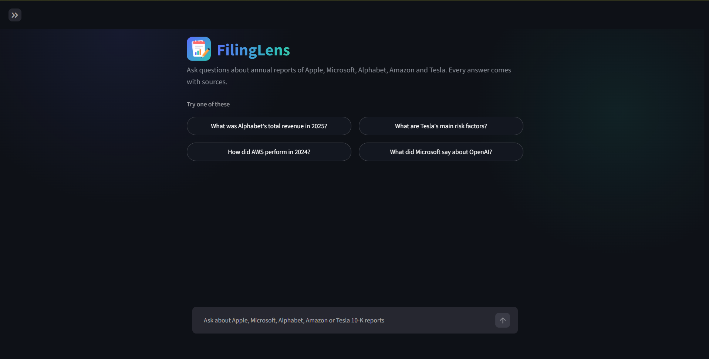

# FilingLens

Ask questions about the annual reports (10-K) of **Apple, Microsoft, Alphabet, Amazon and Tesla** and get answers that come **only from the reports**, with sources you can open and check.



## What it does

- Answers questions such as *"What was Alphabet's total revenue in 2025?"* or *"What are Tesla's main risk factors?"*
- Every answer cites the passages it used (`[1]`, `[2]`, ...). Click a source chip to read the original text.
- If the reports do not contain the answer, it says **"I don't know based on the provided documents."** instead of guessing.
- Chat history, edit-your-question, streaming answers and a thinking animation, like modern AI chat apps.

## How it works

```
SEC EDGAR 10-K filings (HTML)
        |  download, clean the inline-XBRL HTML
        v
   plain text  ->  chunks (1000 characters, 200 overlap, cut at spaces)
        v
   embeddings (all-MiniLM-L6-v2)  ->  ChromaDB (3,863 chunks)

question
   |  detect company and fiscal year -> filter the search
   v
 hybrid search: BM25 (keywords) + semantic search, merged with Reciprocal Rank Fusion
   v
 cross-encoder reranker (ms-marco-MiniLM-L-6-v2) -> top 5 chunks
   v
 Gemini (answer only from the context, cite sources, say "I don't know" otherwise)
   v
 FastAPI (/ask_stream)  ->  Streamlit chat UI
```

Also included: query logging and answer caching (SQLite), input checks and rate limits, a Dockerfile.

## Results

I wrote and checked a test set of 58 questions from the reports (45 for development, 13 held back to check for overfitting) plus 5 questions that the reports cannot answer.

| Check | Result |
|---|---|
| Retrieval hit rate @5, first version (semantic search only) | 78% (35/45) |
| Retrieval hit rate @5, final version, development set | **96% (43/45)** |
| Retrieval hit rate @5, final version, held-out set | **92% (12/13)** |
| Answers containing the correct number (automatic check) | 43/45 |
| Answers with a source citation | 57/57 |
| Correct "I don't know" on questions outside the reports | 5/5 |

What improved retrieval: a larger candidate pool before reranking, and filtering by company and fiscal year when the question names them. The two number checks that did not pass: one was a formatting difference (`$402.8 billion` vs `402,836` million), one was a refusal on a two-year comparison question.

The test set is small and written by me, so treat these numbers as a sanity check, not a benchmark.

## Limitations

- Questions that compare two fiscal years can fail, because the top 5 chunks often come from one year only.
- Tables can be cut across chunk boundaries, which hurts questions about table values.
- The mapping from report to fiscal year is written by hand for these 10 filings (`REPORT_YEAR` in `src/retrieval.py`).
- Protection against prompt injection is basic (phrase filter, length limit, rate limits). There is no login.
- Answer time depends on the Gemini API and the laptop: about 3-4 s in my evaluation runs, up to 10 s at other times.

## Run it yourself

Requires Python 3.12 and a free [Gemini API key](https://aistudio.google.com/).

```bash
python -m venv venv
venv\Scripts\activate            # Windows (on Mac/Linux: source venv/bin/activate)
pip install -r requirements.txt
```

Create a file named `.env` in the project folder:

```
GEMINI_API_KEY=your_key_here
```

Build the data (the SEC asks for a name and email in the downloader's user agent: edit `src/download_data.py` first):

```bash
python src/download_data.py      # download the 10-K filings
python src/parse_documents.py    # clean the HTML into text
python src/vector_store.py       # chunk, embed and index
```

Start the app (two terminals, both with the venv active):

```bash
uvicorn api:app --app-dir src
streamlit run src/app.py
```

Open http://localhost:8501.

Optional checks:

```bash
python src/evaluation.py         # retrieval hit rate on the test questions
python src/answer_eval.py        # answer quality (needs the Gemini key)
python src/stats.py              # timing and token statistics from the query log
```

A `Dockerfile` is included (`docker build -t filinglens .`). It expects the `vectorstore/` folder to exist, so build the index first.

## Project structure

```
src/
  download_data.py   parse_documents.py   chunking.py   vector_store.py
  retrieval.py       generation.py        streaming.py  tracking.py
  guardrails.py      api.py               app.py
  evaluation.py      answer_eval.py       verify_questions.py
  diagnose.py        inspect_misses.py    experiments.py   stats.py
data/eval/           test questions (questions.json, holdout.json)
Dockerfile, start.py, requirements.txt, requirements-deploy.txt
```

## Tech

Python, BeautifulSoup, sentence-transformers, ChromaDB, rank-bm25, Google Gemini (`google-genai`), FastAPI, Streamlit.

The 10-K filings are public documents from [SEC EDGAR](https://www.sec.gov/edgar). This project is for learning and is not financial advice.